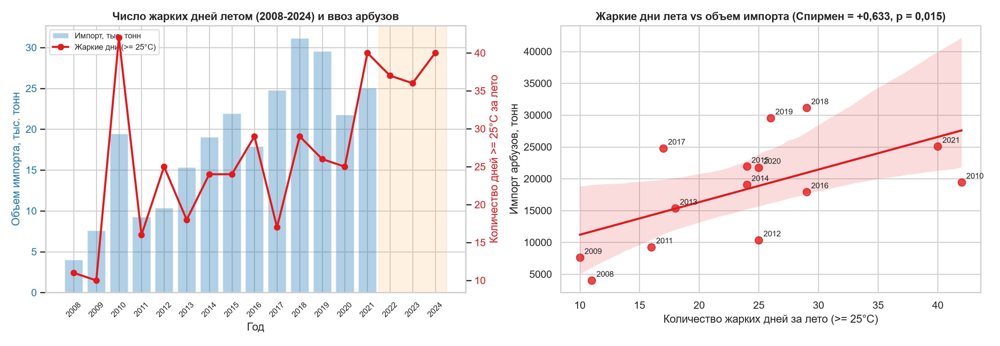

# Анализ и прогнозирование внешней торговли Республики Беларусь: «Арбузы свежие» (ТН ВЭД 080711)

Комплексное экономико-статистическое исследование динамики импорта и экспорта свежих арбузов в Республике Беларусь за 2008-2021 гг., анализ влияния обменного курса `BYN/USD` и летних погодных условий, а также построение трёхлетнего прогноза на 2022-2024 гг. по 4 целевым показателям (количество в тоннах и стоимость в тыс. USD для импорта и экспорта).

---

## Содержание
1. [Источники и подготовка данных](#1-источники-и-подготовка-данных)
2. [Структура проекта](#2-структура-проекта)
3. [Методология исследования](#3-методология-исследования)
4. [Ключевые результаты анализа](#4-ключевые-результаты-анализа)
5. [Сравнение моделей и прогноз на 2022-2024 гг.](#5-сравнение-моделей-и-прогноз-на-2022-2024-гг)
6. [Итоговые выводы](#6-итоговые-выводы)
7. [Инструкция по запуску](#7-инструкция-по-запуску)

---

## 1. Источники и подготовка данных

1. **Внешняя торговля РБ (2008-2021 гг.) - Белстат:**
   - Использованы официальные годовые статистические сборники «Экспорт и импорт товаров Республики Беларусь на уровне 6 знаков ТН ВЭД ЕАЭС» (Раздел II «Продукты растительного происхождения», товарная позиция `080711` - «Арбузы свежие»).
   - **Особенности парсинга (`src/parse_xls.py`):** данные за 2008-2016 гг. представлены в сборниках в формате `.pdf` (с повёрнутыми на 90 градусов таблицами и разбиением разрядов чисел), а за 2017-2021 гг. - в формате `.xls`. Скрипт извлекает строки по коду `080711` через `PyMuPDF` (`fitz`) и `pandas`, учитывает различия структуры таблиц (наличие колонки веса нетто в 2012-2013 гг.), приводит единицы измерения к **тоннам** (перевод из кг при необходимости) и **тыс. долл. США**, а также корректно обрабатывает годы с нулевым экспортом (2010-2011 гг., когда позиция `080711` отсутствовала в экспортной выгрузке).

2. **Официальный курс валют BYN/USD (2008-2024 гг.) - НБРБ (`api.nbrb.by`):**
   - Скрипт `src/fetch_nbrb_rates.py` выгружает ежедневные официальные курсы белорусского рубля к доллару США с 1 января 2008 г. по 31 декабря 2024 г.
   - Учтена смена идентификатора валюты в API НБРБ (`Cur_ID = 145` до 08.07.2021 и `Cur_ID = 431` с 09.07.2021), а также деноминация 1 июля 2016 г. - все значения до 01.07.2016 приведены к современному масштабу цен (`10 000 BYR = 1 BYN`). На основе дневных рядов рассчитаны среднегодовые курсы, медиана и внутригодовая волатильность.

3. **Летние погодные условия в Беларуси (2008-2024 гг.) - Open-Meteo Archive API:**
   - Скрипт `src/fetch_weather.py` загружает исторические ежедневные метеоданные по Минску (географическому центру и крупнейшему рынку потребления страны) за весь период исследования и горизонта прогноза.
   - Для летнего сезона (июнь-август) рассчитаны: средняя температура лета (`summer_temp_mean`), средняя температура пика потребления в июле-августе (`jul_aug_temp_mean`), количество жарких дней с максимальной температурой от 25°C и выше (`hot_days_25`) и сумма летних осадков (`summer_rain_mm`).

---

## 2. Структура проекта

~~~text
task_2/
├── data/
│   ├── raw/                                     # Исходные .pdf (2008-2016) и .xls (2017-2021) файлы Белстата
│   └── processed/                               # Очищенные таблицы и результаты расчётов:
│       ├── watermelons_2008_2021.csv            # Сводный ряд импорта и экспорта арбузов
│       ├── nbrb_usd_daily_2008_2024.csv         # Ежедневный курс BYN/USD (с учётом деноминации)
│       ├── nbrb_usd_annual_2008_2024.csv        # Среднегодовые показатели курса BYN/USD
│       ├── belarus_weather_daily_2008_2024.csv  # Дневные метеоданные по Минску
│       ├── belarus_weather_2008_2024.csv        # Агрегированные летние показатели погоды
│       ├── fx_correlation_results.csv           # Таблица корреляций с курсом BYN/USD
│       ├── model_validation_metrics.csv         # Метрики MAE, RMSE, MAPE на Walk-Forward валидации
│       └── forecasts_2022_2024.csv              # Итоговые прогнозы всех моделей и 95% ДИ
├── figures/                                     # Визуализации результатов анализа:
│   ├── 01_raw_series_overview.png               # Исходные ряды импорта, экспорта и средних цен
│   ├── 02_decomposition_hp.png                  # Декомпозиция рядов (тренд, сезонность, остатки)
│   ├── 03_fx_correlation.png                    # Анализ связи торговли с курсом BYN/USD
│   ├── 03b_weather_impact.png                   # Влияние летней температуры и жарких дней на импорт
│   └── 04_forecast_2022_2024.png                # Итоговый прогноз на 2022-2024 гг. с 95% ДИ
├── notebooks/
│   └── analysis.ipynb                           # Основной Jupyter-ноутбук с кодом, графиками и выводами
├── src/
│   ├── parse_xls.py                             # Парсер сборников Белстата (.pdf и .xls)
│   ├── fetch_nbrb_rates.py                      # Выгрузка и агрегация курсов НБРБ
│   └── fetch_weather.py                         # Выгрузка и агрегация летней погоды Open-Meteo
├── requirements.txt                             # Зависимости Python
└── README.md                                    # Документация проекта
~~~

---

## 3. Методология исследования

### 3.1. Декомпозиция временных рядов
- Исходные ряды Белстата имеют годовую дискретность (14 наблюдений за 2008-2021 гг.). Внутригодовая сезонность потребления арбузов агрегирована внутри годовых итогов, поэтому сезонная компонента на годовом шаге равна нулю.
- Для разделения рядов на плавный долгосрочный тренд и циклические/разовые колебания (остатки) применён **фильтр Ходрика-Прескотта** (`statsmodels.tsa.filters.hp_filter.hpfilter`) со стандартным для годовых макроэкономических рядов параметром сглаживания `lambda = 6.25`.

### 3.2. Корреляционный анализ (курс BYN/USD и погода)
- В качестве основной меры связи выбрана **ранговая корреляция Спирмена**, так как на короткой выборке с девальвационными скачками (2011, 2015, 2020 гг.) она устойчива к выбросам. Коэффициент **Пирсона** рассчитан дополнительно как вспомогательный ориентир.
- Анализ проведён в двух разрезах:
  1. **По исходным годовым уровням** - для оценки общей сонаправленности динамики за 14 лет.
  2. **По годовым приростам (изменениям год к году)** - для устранения эффекта общего временного тренда и выявления реальной реакции рынка на резкие скачки курса валют и изменения погоды.

### 3.3. Валидация и выбор моделей прогнозирования
- Для объективной оценки качества на коротком ряде применена **валидация расширяющимся окном (Walk-Forward Validation)** на 6 последних годах (2016-2021 гг.): модели последовательно обучаются на отрезках `2008-2015`, `2008-2016`, ..., `2008-2020` и прогнозируют следующий год.
- Сравнивались **7 моделей** из статистического и ML-классов:
  1. **ETS (метод Хольта с затухающим трендом)** - экспоненциальное сглаживание уровня и наклона ряда.
  2. **ARIMA(1,1,0)** - авторегрессионная проинтегрированная модель для нестационарных годовых рядов.
  3. **Ridge (базовая)** - регуляризованная линейная регрессия на годовых приростах (лаговые признаки уровня и прироста ряда).
  4. **Ridge (+ курс и погода)** - линейная модель с добавлением годового изменения курса `BYN/USD`, изменения температуры июля-августа и изменения числа жарких дней (`>= 25°C`).
  5. **XGBoost (базовый)** - градиентный бустинг на годовых приростах с ограничением глубины деревьев (`max_depth=2`) против переобучения.
  6. **XGBoost (+ курс и погода)** - бустинг с внешними экзогенными признаками курса валют и летней погоды.
  7. **Ансамбль (ETS + ML)** - усреднение прогнозов статистической модели `ETS` и двух ML-моделей с внешними факторами (`Ridge + курс и погода` и `XGBoost + курс и погода`).
- Лучшая модель для каждого из 4 показателей выбрана по минимальному значению **RMSE** на валидации. Финальные прогнозы на 2022-2024 гг. построены после переобучения моделей на полном историческом ряде (2008-2021 гг.) с подстановкой фактических значений курса `BYN/USD` и погоды за 2022-2024 гг.

---

## 4. Ключевые результаты анализа

### 4.1. Динамика и декомпозиция рядов (2008-2021 гг.)
- **Импорт (физический объём):** вырос более чем в 6 раз - с `4 014 т` в 2008 г. до пика в `31 129 т` в 2018 г., после чего стабилизировался на уровне `21 759 - 29 533 т` (`25 061 т` в 2021 г.). Среднее значение за период - `18 368 т`, медиана - `19 245 т`. Остатки декомпозиции чётко фиксируют положительный всплеск в жарком 2010 г. (`19 439 т`) и провалы в кризисные 2011 (`9 252 т`), 2016 (`17 916 т`) и пандемийный 2020 гг. (`21 759 т`).
- **Импорт (стоимость):** увеличился более чем в 9 раз - с `745,5 тыс. USD` в 2008 г. до максимума в `6 936,0 тыс. USD` в 2021 г. (среднее - `3 639,6 тыс. USD`). В 2020-2021 гг. стоимостной объём рос даже при меньшем тоннаже, чем в 2018 г., из-за роста средних контрактных цен с `124,2 USD/т` (2018 г.) до `276,8 USD/т` (2021 г.).
- **Экспорт (количество и стоимость):** носит нестабильный реэкспортный характер (от `0 т` в 2010-2011 гг. до пика `512 т` / `95,1 тыс. USD` в 2015 г. и `340 т` / `75,4 тыс. USD` в 2018 г.). К 2020-2021 гг. поставки сократились до минимальных `13,5-15,3 т` (`5,3-5,9 тыс. USD`).

### 4.2. Влияние обменного курса BYN/USD
- **В исходных годовых уровнях** наблюдается сильная положительная корреляция между курсом доллара и импортом: по Спирмену `+0,868` (`p = 0,0001`) для стоимости импорта и `+0,820` (`p = 0,0003`) для объёма в тоннах. Однако это эффект общего временного тренда: на протяжении 14 лет одновременно росли и курс доллара (с `0,2136` до `2,5384 BYN`), и внутренний спрос.
- **В годовых приростах (изменениях год к году)** проявляется реальная экономическая реакция рынка: связь между изменением курса и физическим ввозом становится **отрицательной и статистически значимой** (`Спирмен = -0,665`, `p = 0,0132`). В годы резких девальваций (2011, 2016, 2020 гг.) импортные арбузы резко дорожали в рублях, что приводило к сокращению ввоза в тоннах. Для стоимости импорта в USD связь в приростах слабее и статистически незначима (`-0,264`, `p = 0,3839`) из-за встречного роста долларовых закупочных цен.
- **Экспорт от курса BYN/USD не зависит** ни в уровнях (`Спирмен = +0,25 ... +0,34`, `p > 0,2`), ни в годовых изменениях (`p > 0,6`), что подтверждает его эпизодический реэкспортный характер.

### 4.3. Влияние летней погоды
- **Количество жарких дней за лето (`>= 25°C`)** демонстрирует статистически значимую положительную корреляцию с физическим объёмом импорта (`Спирмен = +0,633`, `p = 0,0151`). Аномально жаркое лето 2010 г. (`42` жарких дня при средней температуре июля-августа `21,14°C`) объясняет резкий скачок закупок почти до 20 тыс. тонн.
- **Изменение температуры в пик сезона (июль-август)** положительно коррелирует с годовым приростом как физического (`+0,418`), так и стоимостного (`+0,522`) импорта, тогда как обильные летние осадки дают умеренную отрицательную связь (`-0,222`).

---

## 5. Сравнение моделей и прогноз на 2022-2024 гг.

### 5.1. Результаты Walk-Forward валидации (2016-2021 гг., 6 шагов)

| Показатель | Лучшая модель (min RMSE) | MAE | RMSE | MAPE, % | Роль внешних факторов (курс + погода) |
| :--- | :--- | :---: | :---: | :---: | :--- |
| **Импорт (тонны)** | **Ансамбль (ETS + ML)** | 4 358,50 | **4 897,08** | 17,8% | Существенно улучшили ML-модели (RMSE `XGBoost` снизился с `7 404,7` до `5 335,1`) |
| **Импорт (тыс. USD)** | **XGBoost (базовый)** | 662,07 | **786,28** | 13,3% | Не улучшили прогноз (денежный объём сильнее зависит от мировых цен) |
| **Экспорт (тонны)** | **ARIMA(1,1,0)** | 185,85 | **259,09** | 397,4%* | Не дали прироста точности (реэкспорт не зависит от погоды и курса в РБ) |
| **Экспорт (тыс. USD)** | **ETS (Хольт)** | 38,15 | **46,25** | 417,6%* | Не дали прироста точности |

*\*Примечание: высокие значения `MAPE` на рядах экспорта обусловлены эффектом низкой базы после падения объёмов реэкспорта в 2019-2021 гг. до 5,3-18,5 тыс. USD (13,5-59,5 т). Поэтому выбор моделей для экспорта опирается на абсолютные метрики `RMSE` и `MAE`.*

### 5.2. Итоговый прогноз на 2022-2024 гг. (с 95% доверительным интервалом)

| Показатель | Выбранная модель | 2022 | 95% ДИ (2022) | 2023 | 95% ДИ (2023) | 2024 | 95% ДИ (2024) |
| :--- | :--- | :---: | :---: | :---: | :---: | :---: | :---: |
| **Импорт (тонны)** | Ансамбль (ETS + ML) | **26 696,3** | 20 332,7 - 33 060,0 | **24 205,9** | 15 206,3 - 33 205,4 | **23 591,3** | 12 569,1 - 34 613,4 |
| **Импорт (тыс. USD)** | XGBoost | **6 337,8** | 5 607,5 - 7 068,1 | **6 494,7** | 5 461,9 - 7 527,5 | **6 607,8** | 5 342,9 - 7 872,7 |
| **Экспорт (тонны)** | ARIMA(1,1,0) | **12,2** | 0,0 - 366,0 | **10,7** | 0,0 - 441,4 | **9,3** | 0,0 - 522,3 |
| **Экспорт (тыс. USD)** | ETS (Хольт) | **42,2** | 0,0 - 101,4 | **42,6** | 0,0 - 126,3 | **42,9** | 0,0 - 145,4 |

---

## 6. Итоговые выводы

1. **Устойчивый рост и насыщение импорта:** за 2008-2021 гг. внутренний рынок потребления свежих арбузов в Беларуси многократно вырос и к 2018-2021 гг. вышел на плато насыщения в районе `22-31 тыс. тонн` в год. На горизонте 2022-2024 гг. ожидается сохранение физического импорта на уровне **23,6-26,7 тыс. тонн** в год: тёплые летние сезоны 2022-2024 гг. (`36-40` жарких дней) поддерживают спрос, но ослабление курса `BYN/USD` (до `3,2458` в 2024 г.) сдерживает рост тоннажа.
2. **Сохранение высоких валютных затрат на закупку:** стоимостной объём импорта в 2022-2024 гг. прогнозируется в диапазоне **6,34-6,61 млн USD** в год, оставаясь вблизи исторических максимумов за счёт повышенных контрактных цен и логистических издержек.
3. **Нерегулярный характер экспорта:** экспорт арбузов из РБ не образует устойчивого тренда и не связан ни с курсом рубля, ни с внутренними погодными условиями. Базовый прогноз указывает на сохранение минимальных объёмов (**9-12 тонн** / **42-43 тыс. USD** в год), однако широкий 95% доверительный интервал (до `366-522 тонн`) отражает вероятность разовых реэкспортных поставок.
4. **Методологический вывод по моделированию:** на коротких годовых макрорядах (14 наблюдений) ни один алгоритм не является универсальным. Объединение статистического подхода и ML с экзогенными факторами (`Ансамбль`) показало наилучшую точность для физического спроса, градиентный бустинг (`XGBoost`) - для стоимостного импорта, а классические модели `ARIMA` и `ETS` оказались устойчивее на волатильных рядах реэкспорта.

---

## 7. Инструкция по запуску

~~~bash
# 1. Установка зависимостей
pip install -r task_2/requirements.txt

# 2. Сбор и подготовка данных (при необходимости пересобрать CSV)
python task_2/src/parse_xls.py
python task_2/src/fetch_nbrb_rates.py
python task_2/src/fetch_weather.py

# 3. Запуск ноутбука с анализом, графиками и прогнозами
jupyter notebook task_2/notebooks/analysis.ipynb
~~~