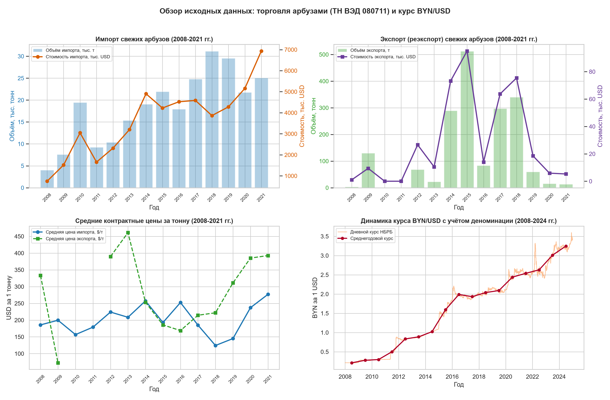
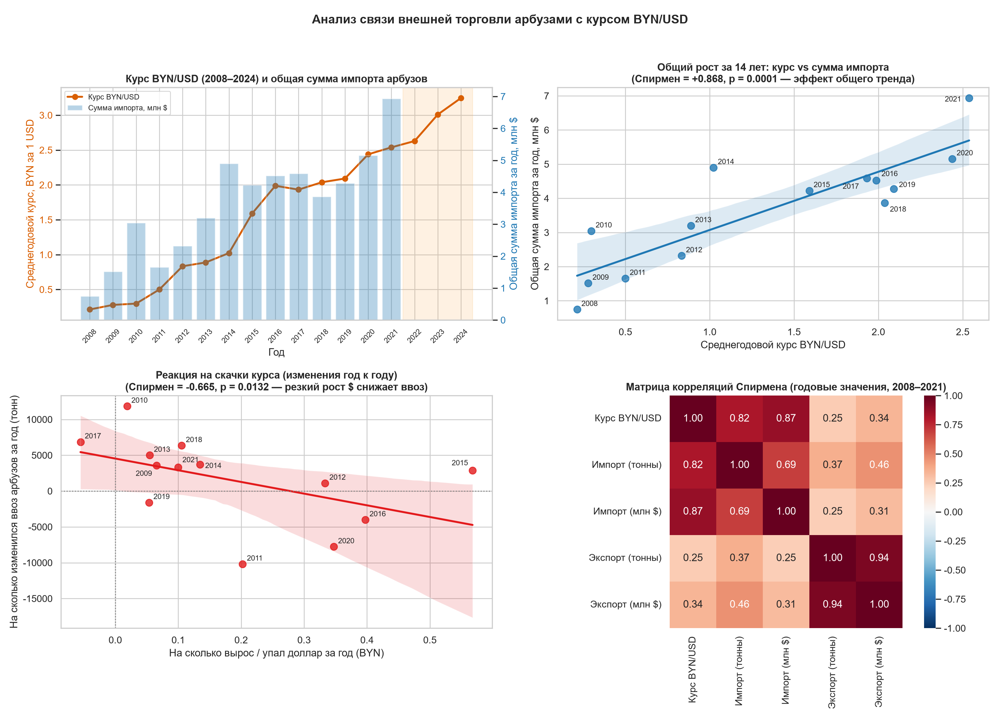
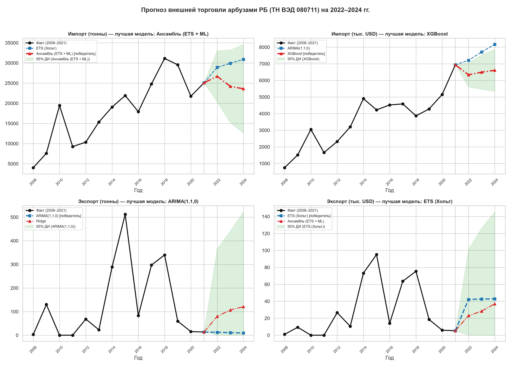

# Анализ и прогнозирование внешней торговли Республики Беларусь: «Арбузы свежие» (ТН ВЭД 080711)

Комплексное экономико-статистическое исследование динамики импорта и экспорта свежих арбузов в Республике Беларусь за 2008–2021 гг., анализ влияния обменного курса `BYN/USD` и летних погодных условий, а также построение трёхлетнего прогноза на 2022–2024 гг. по 4 целевым показателям (количество в тоннах и стоимость в тыс. USD для импорта и экспорта).

---

## Содержание
1. [Источники и подготовка данных](#источники-и-подготовка-данных)
2. [Структура проекта](#структура-проекта)
3. [Методология исследования](#методология-исследования)
4. [Ключевые результаты анализа](#ключевые-результаты-анализа)
5. [Сравнение моделей и прогноз на 2022–2024 гг.](#сравнение-моделей-и-прогноз-на-20222024-гг)
6. [Итоговые выводы](#итоговые-выводы)
7. [Инструкция по запуску](#инструкция-по-запуску)

---

## Источники и подготовка данных

1. **Внешняя торговля РБ (2008–2021 гг.) - Белстат:**
   - Использованы официальные годовые статистические сборники «Экспорт и импорт товаров Республики Беларусь на уровне 6 знаков ТН ВЭД ЕАЭС» (Раздел II «Продукты растительного происхождения», товарная позиция `080711` - «Арбузы свежие»).
   - **Особенности парсинга (`src/parse_xls.py`):** данные за 2008–2016 гг. представлены в сборниках в формате `.pdf` (с повёрнутыми на 90° таблицами и разбиением разрядов чисел), а за 2017–2021 гг. - в формате `.xls`. Скрипт извлекает строки по коду `080711` через `PyMuPDF` (`fitz`) и `pandas`, учитывает различия структуры таблиц (наличие колонки веса нетто в 2012–2013 гг.), приводит единицы измерения к **тоннам** (перевод из кг при необходимости) и **тыс. долл. США**, а также корректно обрабатывает годы с нулевым экспортом (2010–2011 гг., когда позиция `080711` отсутствовала в экспортной выгрузке).

2. **Официальный курс валют BYN/USD (2008–2024 гг.) - НБРБ (`api.nbrb.by`):**
   - Скрипт `src/fetch_nbrb_rates.py` выгружает ежедневные официальные курсы белорусского рубля к доллару США с 1 января 2008 г. по 31 декабря 2024 г.
   - Учтена смена идентификатора валюты в API НБРБ (`Cur_ID = 145` до 08.07.2021 и `Cur_ID = 431` с 09.07.2021), а также деноминация 1 июля 2016 г. - все значения до 01.07.2016 приведены к современному масштабу цен (`10 000 BYR = 1 BYN`). На основе дневных рядов рассчитаны среднегодовые курсы, медиана и внутригодовая волатильность.

3. **Летние погодные условия в Беларуси (2008–2024 гг.) - Open-Meteo Archive API:**
   - Скрипт `src/fetch_weather.py` загружает исторические ежедневные метеоданные по Минску (географическому центру и крупнейшему рынку потребления страны) за весь период исследования и горизонта прогноза.
   - Для летнего сезона (июнь–август) рассчитаны: средняя температура лета (`summer_temp_mean`), средняя температура пика потребления в июле–августе (`jul_aug_temp_mean`), количество жарких дней с максимальной температурой от 25°C и выше (`hot_days_25`) и сумма летних осадков (`summer_rain_mm`).

---

## Структура проекта

```text
task_2/
├── data/
│   ├── raw/                              # Исходные .pdf (2008-2016) и .xls (2017-2021) файлы Белстата
│   └── processed/                        # Очищенные таблицы и результаты расчётов:
│       ├── watermelons_2008_2021.csv     # Сводный ряд импорта и экспорта арбузов
│       ├── nbrb_usd_daily_2008_2024.csv  # Ежедневный курс BYN/USD (с учётом деноминации)
│       ├── nbrb_usd_annual_2008_2024.csv # Среднегодовые показатели курса BYN/USD
│       ├── belarus_weather_daily_2008_2024.csv  # Дневные метеоданные по Минску
│       ├── belarus_weather_2008_2024.csv # Агрегированные летние показатели погоды
│       ├── fx_correlation_results.csv    # Таблица корреляций с курсом BYN/USD
│       ├── model_validation_metrics.csv  # Метрики MAE, RMSE, MAPE на Walk-Forward валидации
│       └── forecasts_2022_2024.csv       # Итоговые прогнозы всех моделей и 95% ДИ
├── figures/                              # Визуализации результатов анализа:
│   ├── 01_raw_series_overview.png        # Исходные ряды импорта, экспорта и средних цен
│   ├── 02_decomposition_hp.png           # Декомпозиция рядов (тренд, сезонность, остатки)
│   ├── 03_fx_correlation.png             # Анализ связи торговли с курсом BYN/USD
│   ├── 03b_weather_impact.png            # Влияние летней температуры и жарких дней на импорт
│   └── 04_forecast_2022_2024.png         # Итоговый прогноз на 2022-2024 гг. с 95% ДИ
├── notebooks/
│   └── analysis.ipynb                    # Основной Jupyter-ноутбук с кодом, графиками и выводами
├── src/
│   ├── parse_xls.py                      # Парсер сборников Белстата (.pdf и .xls)
│   ├── fetch_nbrb_rates.py               # Выгрузка и агрегация курсов НБРБ
│   └── fetch_weather.py                  # Выгрузка и агрегация летней погоды Open-Meteo
├── requirements.txt                      # Зависимости Python
└── README.md                             # Документация проекта





